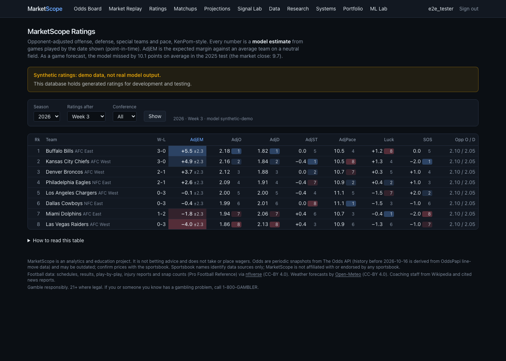
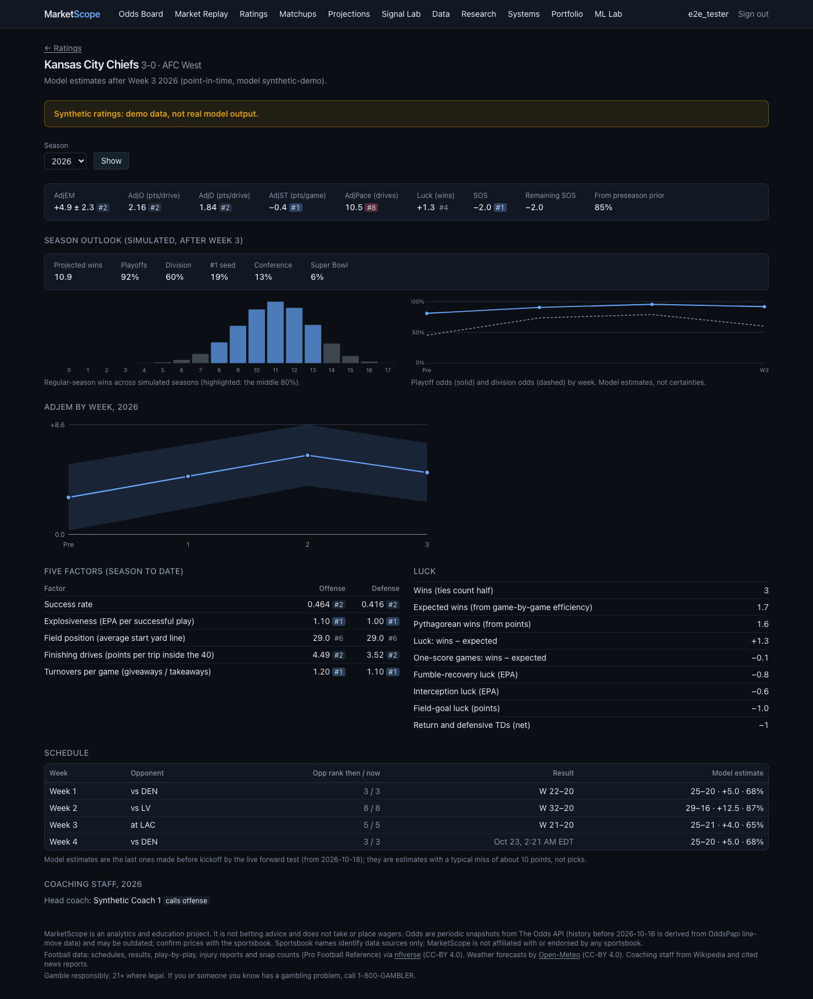
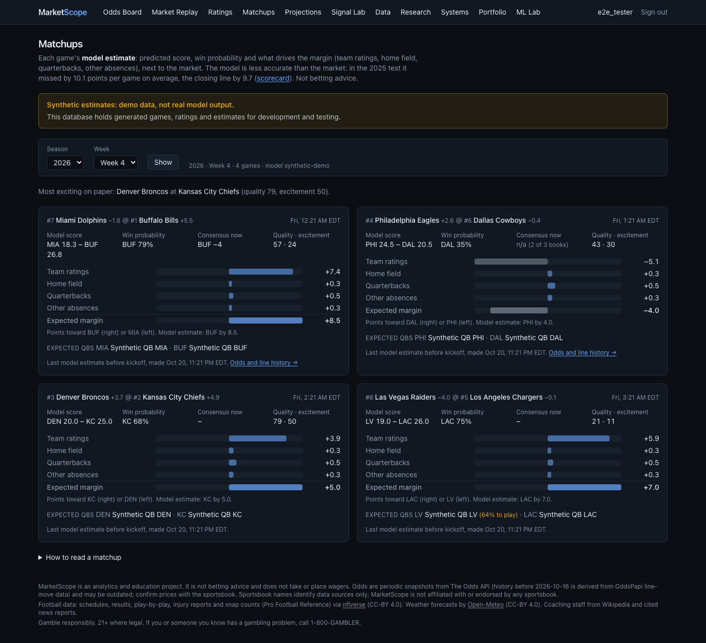
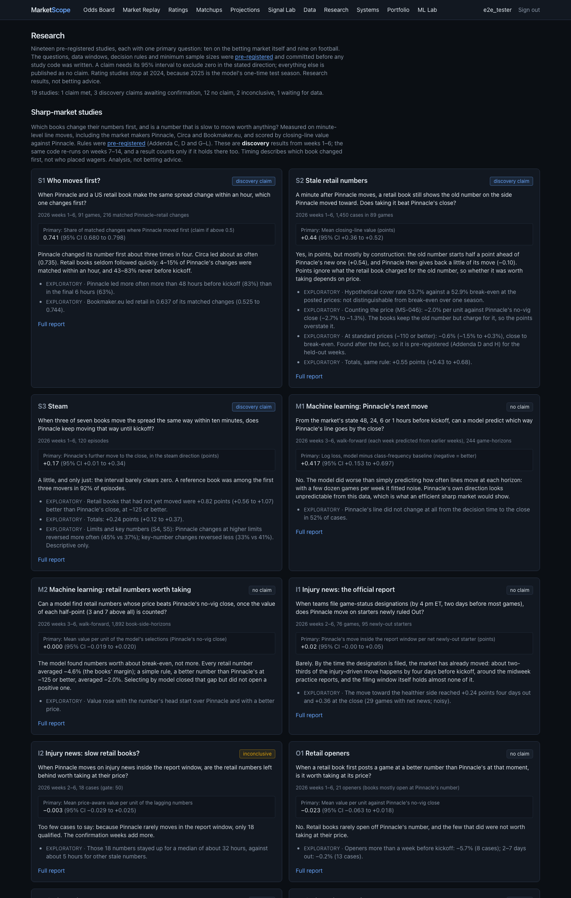
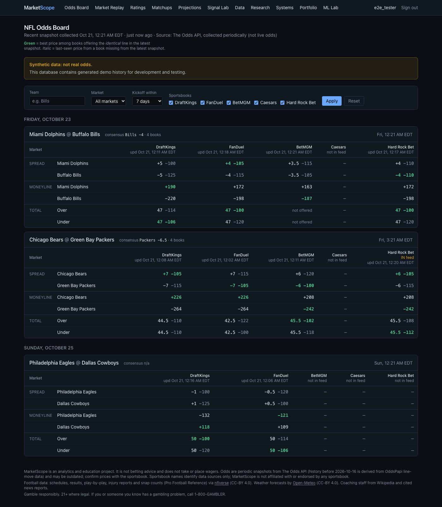
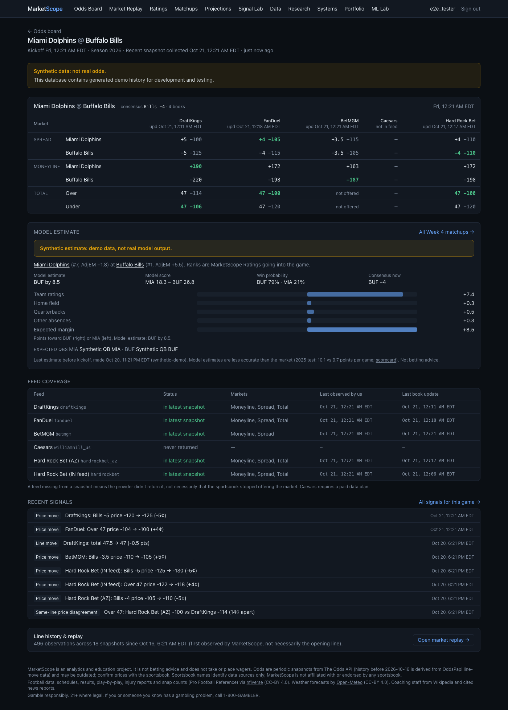
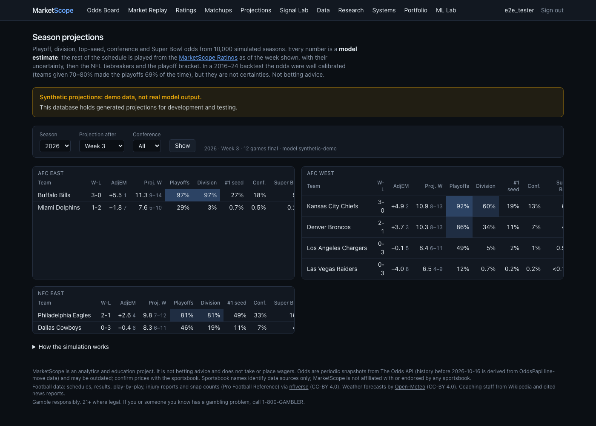
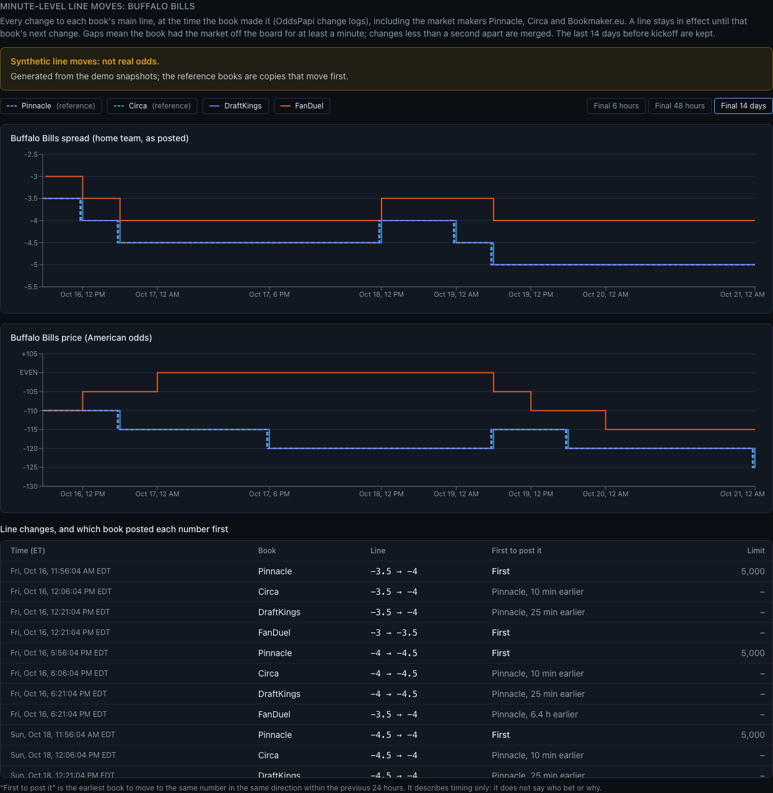
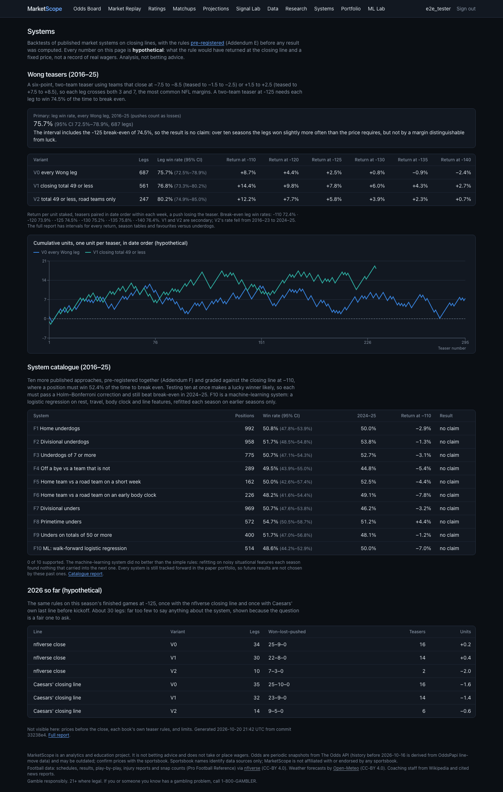
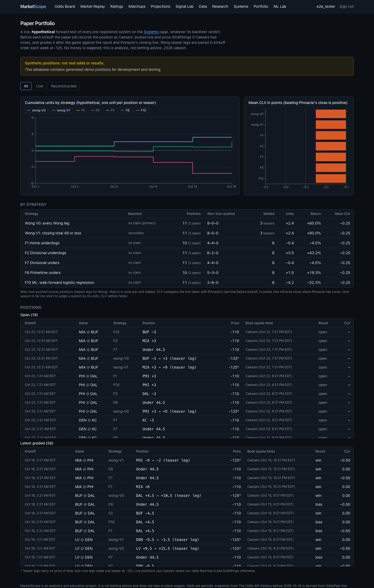

# MarketScope

**NFL sportsbook market intelligence, and "KenPom for the NFL".** Compare the market. Replay its history. Understand the matchup. Investigate the signals. Test the evidence.

MarketScope collects NFL odds from five sportsbooks four times a day and stores every observation, so line history can be replayed exactly. It also keeps minute-level line history for the market makers (Pinnacle, Circa, Bookmaker.eu), retail books and exchanges, to study how the market moves. Next to the market it builds its own football model:

- opponent-adjusted offense, defense and special-teams ratings with uncertainty
- a labelled model line and win probability for every game
- simulated playoff odds
- an immutable live forward test
- pre-registered research that publishes its null results

It is an analytics and education project, not a picks service.

> **Status:** Phases 0–11 are complete, and Phase 12 (the Sharp-Market Lab) has finished its discovery studies; confirmation runs in December 2026. Odds and football data update automatically on a schedule, and the site is deployed on Vercel behind invite-only accounts. Start with the [case study](docs/CASE_STUDY.md), then [`docs/PROJECT_STATUS.md`](docs/PROJECT_STATUS.md) and [`docs/ROADMAP.md`](docs/ROADMAP.md).



_All screenshots show the synthetic demo database used by the end-to-end tests (each page says so). Real odds are never committed._

## What's in it

- **Odds board and replay.** Compares five books at identical lines only, marks the best price, and shows missing books as missing. Line history can be replayed snapshot by snapshot, with the moves between observations.
- **MarketScope Ratings.**
  - **Engine:** a Kalman filter over offense, defense and special-teams strength, built from luck-adjusted, opponent-adjusted EPA. Parameters were fitted on 2016–22 and frozen.
  - **Columns:** AdjEM, AdjO, AdjD, AdjST and AdjPace with ranks and ± ranges, luck, strength of schedule and Five Factors. Every week since 2016 is available as of that week.
- **Model estimates.** A predicted score and win probability for every game, explained term by term, with the injury and QB adjustments.
  - **2025 test, run once:** margin error 10.06 points per game, against 9.67 for the closing line, 10.19 for 538-style Elo and 11.02 for home field alone.
  - **2026:** a live forward test with estimates stored before kickoff.
- **Season projections.** 10,000 simulated seasons with NFL tiebreakers, giving playoff, division, #1 seed and Super Bowl odds. The tiebreakers reproduce every 2016–24 playoff field.
- **Research and ML Lab.** Nineteen pre-registered studies (ten on the market, nine on football) plus the market-movement ML experiments (`/research`, `/ml-lab`). The questions and decision rules were committed before the code. Most results are nulls and all are published. One football claim met its bar (the consensus moves about 0.4 points per starter newly ruled Out during the week), and on the market side Pinnacle moving first is a discovery claim awaiting December's confirmation run.

- **Sharp-Market Lab.**
  - **Minute-level line moves** on every game page, with which book posted each number first.
  - **Market studies:** who moves first, stale numbers, steam, ML on market state, injury timing, openers, totals and exchanges. All are scored by price-aware closing-line value against Pinnacle's no-vig close, with discovery and confirmation splits.
  - **Systems** (`/systems`): Wong teasers and ten more public systems, backtested 2016–25.
  - **Paper portfolio** (`/portfolio`): every system tracked live with immutable pre-kickoff positions.
  - **Headline:** Pinnacle moves first, but the books and exchange traders charge for the lag. No pattern was worth taking at its price in discovery.

| Ratings and team pages                                 | Matchups (FanMatch-style)                          | Research                                                 |
| ------------------------------------------------------ | -------------------------------------------------- | -------------------------------------------------------- |
|         |  |        |
| **Odds board**                                         | **Game page**                                      | **Season projections**                                   |
|       |     |  |
| **Minute-level line moves**                            | **Systems**                                        | **Paper portfolio**                                      |
|  |    |      |

## Stack

- **Web:** Next.js 16 (App Router, server components), React 19, TypeScript 5.9 strict, Tailwind CSS 4
- **Odds collector:** Node.js 22 worker in TypeScript, with Zod-validated config and provider responses
- **Football pipeline and research:** Python 3.11 with pandas, polars, numpy, scipy, scikit-learn and nflreadpy
- **Data:** PostgreSQL 17 on Supabase, Drizzle ORM, committed SQL migrations, row-level security on every table; invite-only accounts via Better Auth
- **Jobs and CI:** GitHub Actions. Odds 4 times a day, football data daily. CI runs lint, types, unit, integration, pytest, Playwright e2e and axe-core accessibility checks.
- **Data sources:**
  - [The Odds API](https://the-odds-api.com/) and OddsPapi (history)
  - [nflverse](https://github.com/nflverse) (CC-BY 4.0)
  - [Open-Meteo](https://open-meteo.com/) (CC-BY 4.0)

The full system diagram is in [`docs/ARCHITECTURE.md`](docs/ARCHITECTURE.md).

## Repository layout

```
apps/web          Next.js site: board, replay, ratings, teams, matchups, projections, model, research
apps/collector    odds collector (The Odds API), OddsPapi importer, synthetic seed
apps/football     nflverse ingest, team-game stats, coaching staff, weather, ratings, simulation, forward test
packages/db       Drizzle schema, migrations, every SQL query, test helpers
packages/shared   pure domain logic: odds math, normalization, consensus, replay, signals
research/         read-only studies and the market-movement ML (pre-registered)
docs/             roadmap, status, decisions (ADRs), architecture, data dictionary, ratings, model card
```

## Getting started

Requirements: Node ≥ 22.12 (`nvm use`), pnpm 10 (`corepack enable`), PostgreSQL 17, and Python 3.11 for the football pipeline and research.

```bash
pnpm install

# Local database (macOS / Homebrew)
brew install postgresql@17 && brew services start postgresql@17
createdb marketscope_dev && createdb marketscope_test
cp packages/db/.env.example packages/db/.env.local
cp apps/web/.env.example apps/web/.env.local
pnpm db:migrate

# Synthetic demo data in its own database (no API key needed; the seed refuses non-demo databases)
createdb marketscope_demo
DATABASE_URL=postgres://localhost:5432/marketscope_demo pnpm db:migrate
DATABASE_URL=postgres://localhost:5432/marketscope_demo pnpm --filter @marketscope/collector seed:synthetic --reset

# The site is invite-only, so create a local account (hidden password prompt)
DATABASE_URL=postgres://localhost:5432/marketscope_demo pnpm --filter @marketscope/web users create --username demo --email demo@example.com

DATABASE_URL=postgres://localhost:5432/marketscope_demo pnpm dev   # http://localhost:3000 → sign in
```

Quality checks (CI runs all of these):

```bash
pnpm format:check && pnpm lint && pnpm typecheck && pnpm test && pnpm build
createdb marketscope_e2e_test   # once
pnpm --filter @marketscope/web exec playwright install chromium   # once
pnpm --filter @marketscope/web build && pnpm --filter @marketscope/web test:e2e
(cd apps/football && python3 -m venv .venv && .venv/bin/pip install -r requirements.txt && PYTHONPATH=src .venv/bin/python -m pytest -q)
(cd research && python3 -m venv .venv && .venv/bin/pip install -r requirements.txt && PYTHONPATH=src .venv/bin/python -m pytest -q)
```

Collecting real odds needs a key from The Odds API in `apps/collector/.env.local`; never commit it. See [`docs/DEPLOYMENT.md`](docs/DEPLOYMENT.md) for production. Every command is listed in [`CLAUDE.md`](CLAUDE.md#commands-run-from-repo-root).

## Principles

- Prices are compared only at an **identical line**. Home −3.5 at −110 and home −3 at −115 are different bets.
- Missing data is shown as missing. Nothing is invented or carried forward.
- "First observed" is not the opening line, and "last observed" is not the closing line.
- **Point in time everywhere.** Ratings, features and estimates use only data available before the moment they describe, and tests check this.
- Model output is labelled "model estimate" and shown with its measured error. Predictions are never edited after the fact.
- The displayed rating uses no market inputs. Research is pre-registered, and nulls are published.

## Documentation

- [Case study](docs/CASE_STUDY.md) · [Roadmap](docs/ROADMAP.md) · [Project status](docs/PROJECT_STATUS.md) · [Decisions](docs/DECISIONS.md)
- [Architecture](docs/ARCHITECTURE.md) · [Data dictionary](docs/DATA_DICTIONARY.md) · [API](docs/API.md) · [Performance](docs/PERFORMANCE.md)
- [Ratings design and results](docs/RATINGS.md) · [Model card](docs/MODEL_CARD.md) · [Research](research/README.md) · [Pre-registration](research/PREREGISTRATION.md)
- [Security](docs/SECURITY.md) · [Accessibility](docs/ACCESSIBILITY.md) · [Provider coverage](docs/PROVIDER_COVERAGE.md) · [Signal definitions](docs/SIGNAL_DEFINITIONS.md)

MarketScope is an analytics and education project. It doesn't place bets or give betting advice. Sportsbook names identify data sources only.
