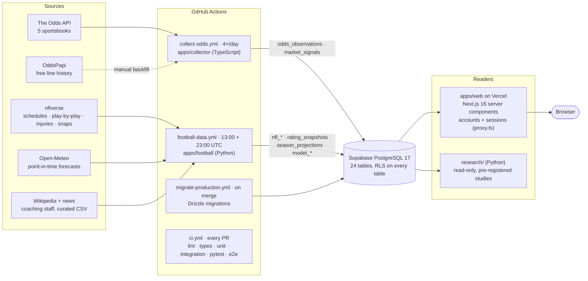

# Architecture

MarketScope has three writers and one reader around a single PostgreSQL database:

- **TypeScript odds collector:** writes odds observations.
- **Python football pipeline:** writes the nflverse data, ratings and model output.
- **Read-only Python research package:** reads everything to run the studies.
- **Next.js site:** reads the same tables.

Every writer is a scheduled GitHub Actions job, and every write is idempotent per job key.

## System diagram

## The pipeline in order

1. **Odds** (`apps/collector`, 4 times a day). The run:
   - claims a job key;
   - checks the credit budget;
   - fetches odds for five books (no database transaction is held open during the fetch);
   - normalises the response to home/away and exact lines;
   - writes one transaction of append-only `odds_observations` and recomputes `market_signals`.

   OddsPapi history was imported once, as snapshots derived from its change log (ADR-026).

2. **Football data** (`apps/football`, daily). Writes nflverse schedules and results (linked to odds events), team-game stats from play-by-play, snap counts and injury reports. Live injury reports are first-seen snapshots, twice a day. Game context and Open-Meteo forecasts come from the same job.
3. **Ratings** (same job). The Kalman filter replays every week since 2012 with the frozen ratings-v1 parameters and writes the point-in-time `rating_snapshots`, in the KenPom contract: AdjEM, AdjO, AdjD, AdjST, AdjPace, luck and SOS.
4. **Model output.** Two parts:
   - The live forward test appends pre-kickoff estimates to `model_predictions`; they are never updated.
   - The season simulation (10,000 seasons, NFL tiebreakers) writes `season_projections`.
5. **Site** (`apps/web`). Server components call `lib/server/*`, which calls the query functions in `packages/db`. `/api/*` exposes the same functions as JSON, behind the same password.
6. **Research** (`research/`, run on demand). Reads with a read-only session. Its study rules are committed before the code (`research/PREREGISTRATION.md`, `ml/design*.py`).

## Schema overview

| Group             | Tables                                                                                                                                                                               | Written by                                | Notes                                                                                                                        |
| ----------------- | ------------------------------------------------------------------------------------------------------------------------------------------------------------------------------------ | ----------------------------------------- | ---------------------------------------------------------------------------------------------------------------------------- |
| Odds              | `events`, `bookmakers`, `ingestion_runs`, `ingestion_payloads`, `odds_observations`, `market_signals`                                                                                | collector                                 | Observations are append-only. One row per selection, per run and per snapshot. Lines keep their posted signs.                |
| Football          | `nfl_teams`, `nfl_games`, `nfl_team_game_stats`, `nfl_player_game_snaps`, `nfl_injury_reports`, `nfl_coaching_staff`, `nfl_weather_forecasts`, `nfl_game_context`, `nfl_ingest_runs` | football pipeline                         | `nfl_games.event_id` links each game to its odds event. The nflverse close is a labelled benchmark and never an observation. |
| Accounts          | `auth_users`, `auth_sessions`, `auth_accounts`, `auth_verifications`, `auth_rate_limits`                                                                                             | web app (Better Auth) and the account CLI | Invite-only. Passwords are hashed in `auth_accounts`.                                                                        |
| Ratings and model | `rating_snapshots`, `season_projections`, `model_runs`, `model_predictions`                                                                                                          | football pipeline                         | Snapshots are filtered (point in time). Predictions are immutable; a new model version means new rows.                       |

The full column reference is in `DATA_DICTIONARY.md`. Hot queries and their EXPLAIN plans are in `PERFORMANCE.md`.

## Boundaries

- **Provider adapters** are the only code that knows a provider's response shape: `packages/shared/src/providers/the-odds-api` and `apps/collector/src/providers/oddspapi`. Everything downstream uses domain types.
- **Persistence:** `packages/db` owns the schema, migrations and every SQL query the site runs. Database constraints enforce the domain invariants a second time:
  - a point exists exactly when the market has lines
  - each selection belongs to its market
  - prices are valid
  - probabilities are in range
- **Pure logic is kept apart from I/O, so it's unit-testable:**
  - `packages/shared`: odds math, consensus, replay, signals
  - `apps/web/lib/*-view.ts`: view models
  - the football features and filters
  - the research study functions
- **Python writes only `nfl_*`, `rating_*` and `model_*`, plus `season_projections`.** The schema stays in Drizzle, so there is one migration history and one drift check, and RLS covers every table.
- **Point in time everywhere.** Ratings, availability, forecasts and features use only data available before the moment they describe. Tests enforce this:
  - truncation invariance of the walk-forward runner
  - leakage audits that perturb the future
  - filtered snapshots that don't change when later games are added
- **Health vs history:** run-health queries count only live runs, so historical imports never make collection look healthy (ADR-027).

## Security model

- **Site:** reachable on the public internet, but every page and `/api/*` route requires a signed-in account (Better Auth sessions in Postgres, invite-only; `apps/web/proxy.ts`, ADR-049). Only `/login`, `/api/auth/*` and `/api/health/live` are open. The Odds API terms forbid redistributing its data through our own API, so `/api/*` needs a session too.
- **Database:** the Supabase REST API is locked out of every table by RLS. The site and jobs connect as Postgres users through the pooler.
- **Secrets:**
  - The site has only `DATABASE_URL` (Vercel). The jobs use one GitHub secret. Local copies sit in gitignored `.env.local` files.
  - The collector strips the API key from logged errors, and logs never contain URLs.
- **Audit:** see `SECURITY.md` (MS-037).

## Key technology choices

The details are in `DECISIONS.md`.

- **TypeScript side:** a pnpm monorepo with internal packages that ship their TypeScript source, TS 5.9 strict, Next.js 16, React 19, Tailwind 4, Zod 4, Vitest 5, Playwright and axe-core. Drizzle and postgres.js run on PostgreSQL 17.
- **Python side:** Python 3.11, with numpy, scipy, pandas, polars, pyarrow and nflreadpy for data and fitting, scikit-learn for the market-movement baselines, and psycopg for writes.
